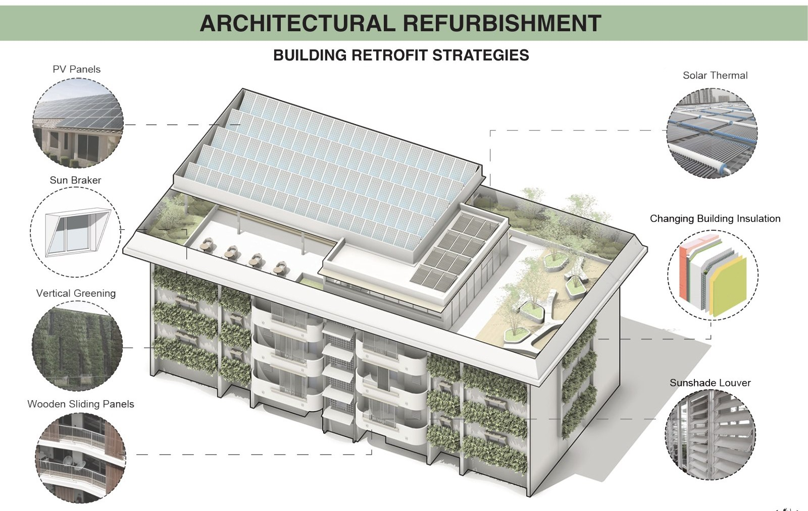
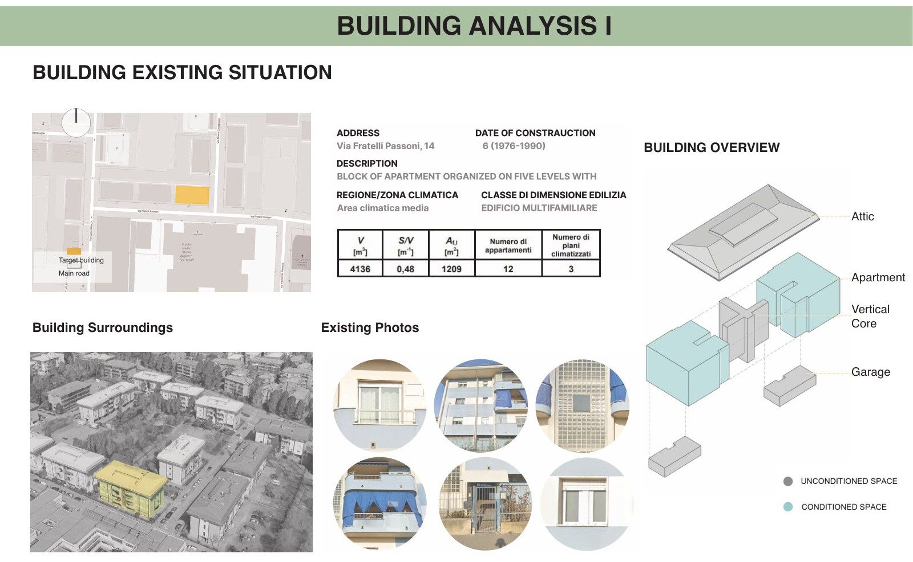
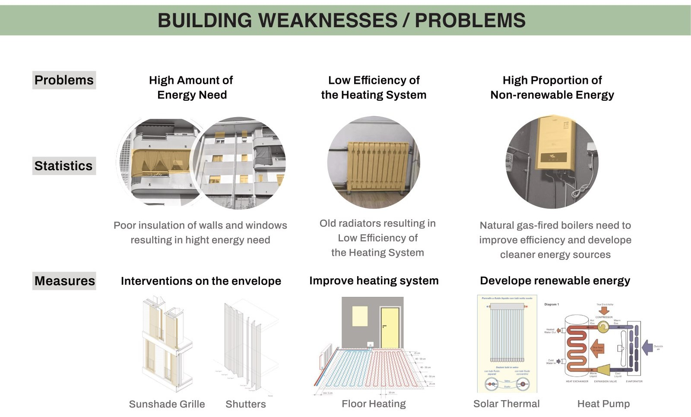
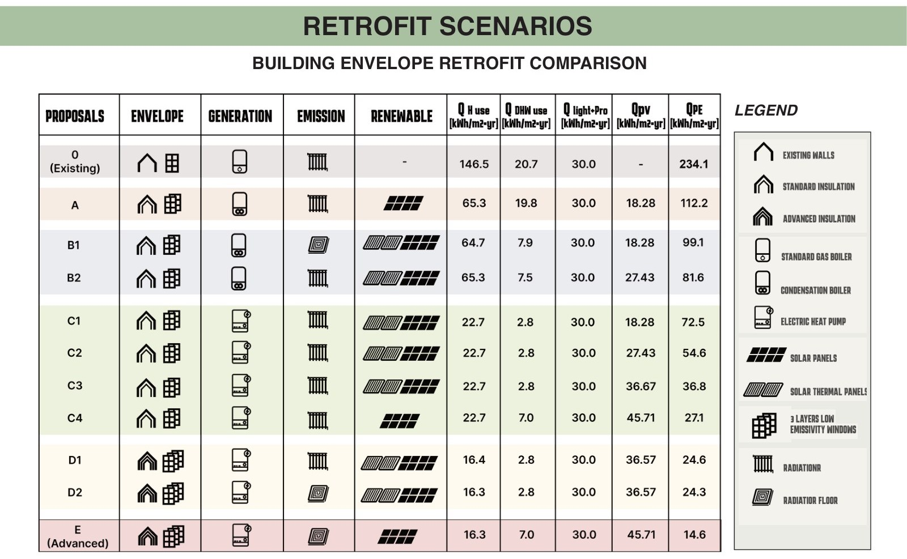
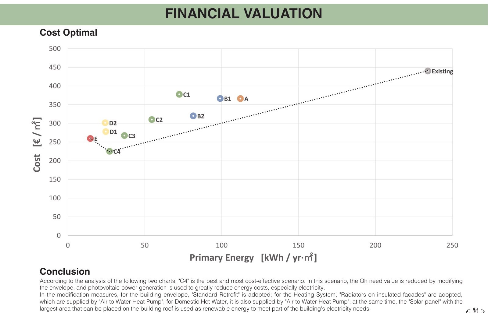

## Energy-Conscious Design of a Post-Carbon Building

**后碳时代建筑的节能设计——都灵既有住宅建筑改造**

**Project Team:** Wei Feng · Haopeng Yang · Tian Zhou · Minjun Ye · Lingyu Zhu  
**Instructors:** Stefano Paolo Corgnati · Cristina Becchio · Marco Luciano  
**Academic Year:** 2023–2024 · Politecnico di Torino

This project investigated the energy-efficient refurbishment of an existing multifamily residential building on Via Fratelli Passoni in Turin, Italy. Beginning with an assessment of the building's envelope, heating systems, and energy demand, the project identified the limitations of the existing building and developed alternative retrofit scenarios combining envelope improvements, more efficient building services, and renewable energy technologies.

The scenarios were evaluated through energy-performance analysis and global cost comparisons. The study identified **Scenario C4** as the preferred cost-optimal solution, integrating standard envelope retrofit measures, an air-to-water heat pump for space heating and domestic hot water, and rooftop photovoltaic panels. The technical findings informed an architectural refurbishment proposal incorporating façade upgrades, shading, greening, and reconfigured shared spaces.

本项目以意大利都灵 Via Fratelli Passoni 的既有多户住宅建筑为研究对象，围绕建筑围护结构、供暖系统与能源需求开展现状评估，识别建筑保温性能不足、设备效率偏低及化石能源依赖等问题。在此基础上，提出围护结构优化、建筑设备更新与可再生能源利用相结合的多种节能改造情景。

研究通过建筑能耗分析与全局成本比较评估不同方案，选取 **C4 情景**作为成本最优的推荐方案，综合采用标准围护结构改造、空气源—水热泵供暖及生活热水系统、屋顶光伏等措施。最终将性能评估转化为建筑更新设计，探索立面遮阳、绿化及共享空间改善与节能技术的协同整合。

<h4 class="text-center mt-5">Selected Drawings</h4>

  

    <button type="button" class="df-slide is-center" data-index="0" data-title="Architectural Retrofit Strategies" aria-label="Show architectural retrofit strategies">
      
    </button>
    <button type="button" class="df-slide is-right" data-index="1" data-title="Existing Building and Site Analysis" aria-label="Show existing building analysis">
      
    </button>
    <button type="button" class="df-slide" data-index="2" data-title="Energy Performance Issues and Retrofit Measures" aria-label="Show building energy issues">
      
    </button>
    <button type="button" class="df-slide" data-index="3" data-title="Comparison of Energy Retrofit Scenarios" aria-label="Show retrofit scenario comparison">
      
    </button>
    <button type="button" class="df-slide" data-index="4" data-title="Cost-Optimal Retrofit Scenario" aria-label="Show cost optimal analysis">
      
    </button>
  

  

    <button type="button" class="df-prev" aria-label="Previous drawing">&#8249;</button>
    01 / 07
    <button type="button" class="df-next" aria-label="Next drawing">&#8250;</button>
  

  

    

      DRAWING 01
      /
      <strong class="df-group-title">Architectural Retrofit Strategies</strong>
    

    

  

