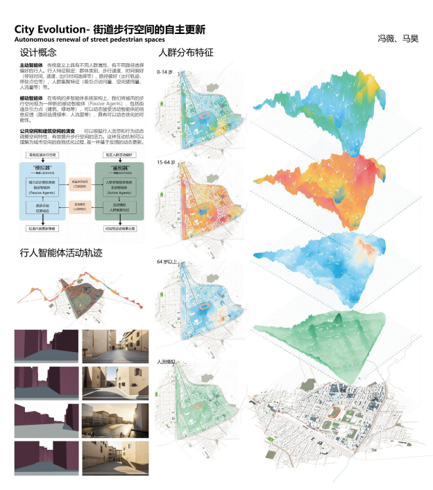

Participated in **Decoding Syntax**, a workshop held as part of the **Computational Design Academic Conference 2024 (CDAC 2024)** in Shanghai, China, exploring computational and generative approaches to architectural and urban design.

参与2024计算性设计学术论坛（CDAC 2024）工作营 **“Decoding Syntax”**，围绕计算性设计与生成式设计方法，探索其在建筑与城市空间设计中的应用。

### City Evolution · Autonomous Transformation of Pedestrian Spaces

**City Evolution · 街道步行空间的自主更新**

**Wei Feng 冯薇**, [Hao Ma 马昊](/people/mahao) 

The project explores the evolution of public and architectural spaces through interactions between active agents (pedestrians) and passive agents (spatial elements). By analyzing relationships between pedestrian movement trajectories and urban spatial configurations, the system dynamically adjusts pedestrian spaces to enhance urban vitality and explore the potential for spatial self-optimization.

项目关注公共空间与建筑空间的演变，通过主动智能体（行人）与被动智能体（空间要素）之间的交互，分析行人活动轨迹与城市空间组织之间的关系，并动态调整步行空间特征，以提升空间活力，探索城市空间自主优化的可能性。

<h4 class="text-center mt-5">Links</h4>

  

  

    Decoding Syntax：城市生成设计网络
  

  

    2024计算性设计学术论坛工作营成果
  

  

    Lab. AAA · 微信公众号
    查看原文 ↗
  

