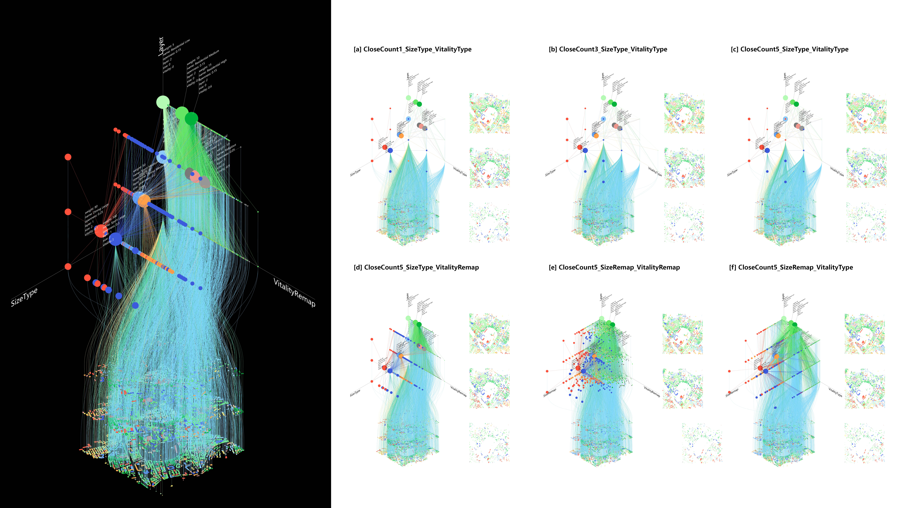
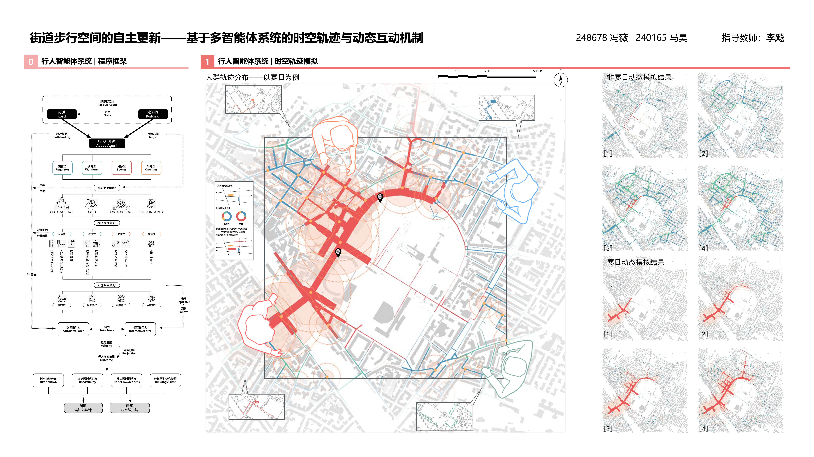
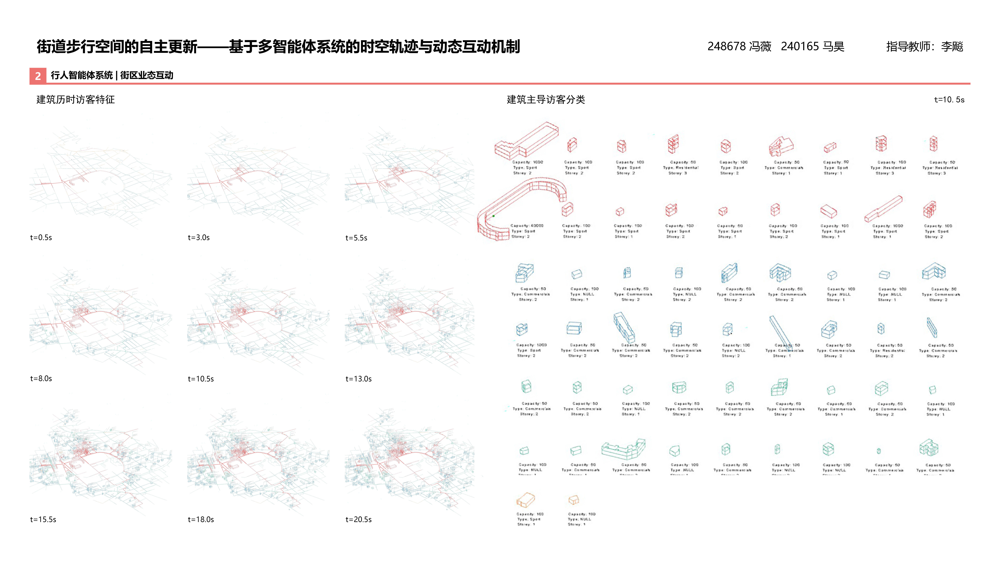
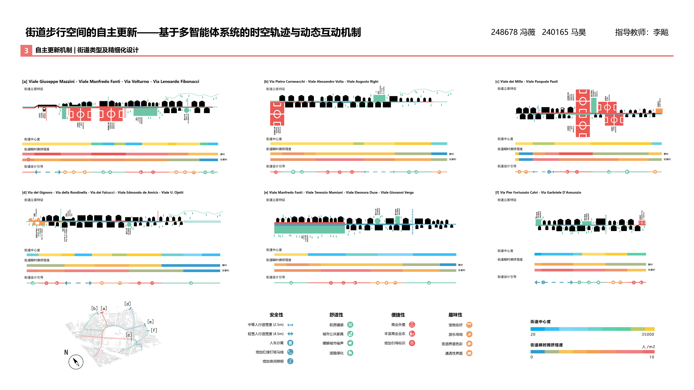
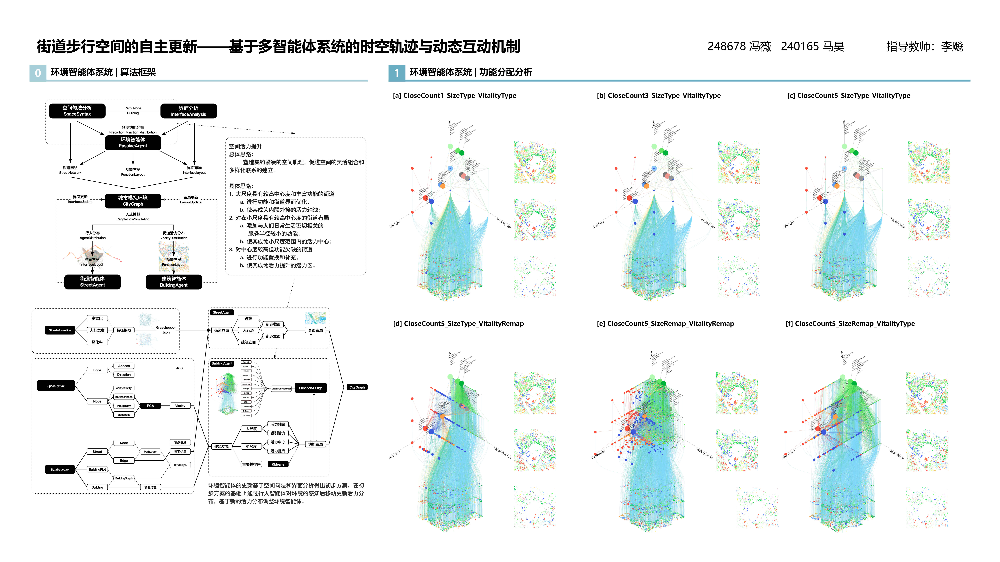
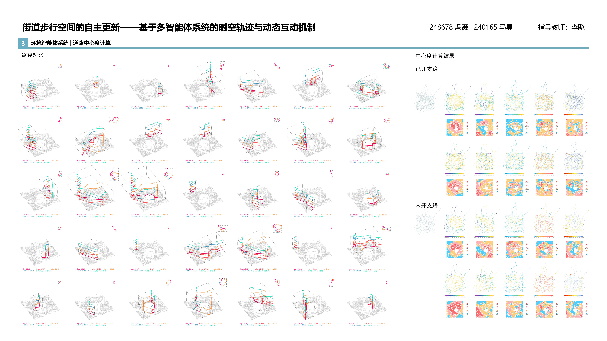
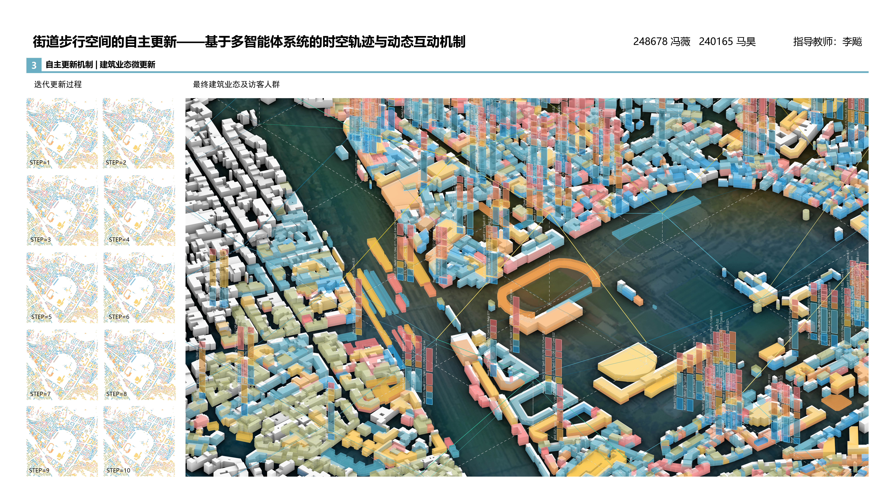

## City Evolution · Adaptive Transformation of Urban Pedestrian Spaces

**City Evolution · 城市演化：街道步行空间的自主更新**

**Wei Feng 冯薇**, [Hao Ma 马昊](https://archialgo.com/people/mahao)

City Evolution is an urban design studio project situated in Florence, Italy. The project investigates the dynamic relationships between urban spatial configurations and pedestrian behavior, exploring how computational simulations can inform adaptive interventions in existing urban environments.

Through a multi-agent simulation framework, pedestrians are modelled as active agents responding to spatial configurations, functional attractions, and interactions with other pedestrians. By examining movement trajectories, spatial accessibility, and variations in pedestrian activity, the project identifies opportunities for the adaptive transformation of streets and surrounding urban spaces.

The resulting design strategies explore adjustments to pedestrian spaces and the functional organization of adjacent buildings, aiming to improve spatial vitality and responsiveness to changing patterns of urban activity.

City Evolution 是一项以意大利佛罗伦萨弗兰基球场为研究场地的城市设计课程项目。项目关注城市空间形态与行人行为之间的动态关系，探索如何通过计算模拟理解既有城市环境，并将行为分析转化为适应性的空间设计干预。

研究基于多智能体模拟框架，将行人视为能够感知环境并产生行为响应的主动智能体，结合空间结构、功能吸引以及行人之间的交互关系，模拟城市空间中的步行活动。通过分析行人运动轨迹、空间可达性及不同条件下的活动分布，识别街道与周边城市空间的优化机会。

在此基础上，项目提出街道步行空间调整与沿街建筑功能微更新等设计策略，探索城市空间如何响应不断变化的活动需求，并通过空间与行为之间的反馈实现动态优化。

<h4 class="text-center mt-5">Demo</h4>

  

    <button type="button" class="df-slide is-center" data-index="0"
            data-title="Project Overview"
            aria-label="Show Project Overview">
      
    </button>

    <button type="button" class="df-slide is-right" data-index="1"
            data-title="Pedestrian Agent System: Program Framework and Spatio-Temporal Trajectory Simulation"
            aria-label="Show Drawing 01">
      
    </button>

    <button type="button" class="df-slide" data-index="2"
            data-title="Pedestrian Agent System: Block Program Interaction and Visitor Classification"
            aria-label="Show Drawing 02">
      
    </button>

    <button type="button" class="df-slide" data-index="3"
            data-title="Autonomous Renewal Mechanism: Street Typologies and Fine-Grained Design"
            aria-label="Show Drawing 03">
      
    </button>

    <button type="button" class="df-slide" data-index="4"
            data-title="Environmental Agent System: Algorithmic Framework and Functional Allocation Analysis"
            aria-label="Show Drawing 04">
      
    </button>

    <button type="button" class="df-slide" data-index="5"
            data-title="Environmental Agent System: Road Centrality Calculation"
            aria-label="Show Drawing 05">
      
    </button>

    <button type="button" class="df-slide is-left" data-index="6"
            data-title="Environmental Agent System: Functional Allocation Configurations"
            aria-label="Show Drawing 06">
      
    </button>

  

  

    <button type="button" class="df-prev" aria-label="Previous drawing">&#8249;</button>
    01 / 07
    <button type="button" class="df-next" aria-label="Next drawing">&#8250;</button>
  

  

    

      DRAWING 01
      /
      <strong class="df-group-title">Project Overview</strong>
    

    

  

