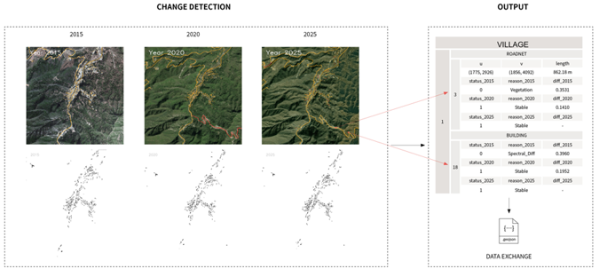

This ongoing research project aims to develop a spatio-temporal building dataset covering **8,155 traditional villages across China**, supporting the study of settlement morphology, spatial organization, and transformation. The research combines **computer vision, multi-temporal remote sensing, and multi-source geospatial data integration** to explore scalable approaches to the automated extraction, integration, and temporal representation of built heritage data.

本项目是一项正在开展的研究，旨在构建覆盖全国 **8,155 个中国传统村落**的建筑时空数据集，为历史乡村聚落的建筑形态、空间组织及其演变研究提供基础数据。研究综合运用**计算机视觉、多时相遥感分析与多源地理空间数据融合**等技术，探索大规模建成遗产空间数据的自动化提取、整合与时序表征方法。

  

Research Preview · © 2026 Wei Feng. 